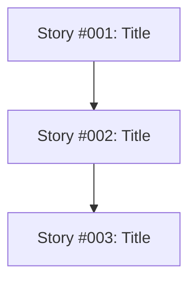

# Skill: Stories (EN)

This guide describes how to generate user stories from a specification considering documentation and test automation.

## What I Do

I break down a specification into actionable user stories, taking into account software documentation and test automation. Each story must bring proven value to the end user.

## When to Use Me

Use this skill when you have a project specification and want to generate structured, testable, and documented user stories.

## File layout (`docs/stories/`)

Stories live under `docs/stories/`. Each story has its own **`<id>`** as a 3-digit number (`001`, `004`, …) — normalize user input (`1` → `001`, `story-004` → `004`).

```text
docs/stories/
  <id>/
    story.md              # user story content
  questions.md            # BLOCKING questions only (temporary — deleted when done)
  assumptions.md          # assumptions proposed by the agent (temporary — deleted when done)
  plan-implementation.md  # cross-story implementation plan (end of workflow)
```

| File | Role |
|------|------|
| `docs/stories/<id>/story.md` | User story #XXX (title, criteria, tests, dependencies) |
| `docs/stories/questions.md` | **Blocking** questions requiring explicit arbitration (may be omitted if none) |
| `docs/stories/assumptions.md` | Non-blocking assumptions proposed by the agent with justification |
| `docs/stories/plan-implementation.md` | Implementation order and dependencies across stories |

**Tasks** for a story are created by the `tasks-en` skill under `docs/stories/<id>/story/`; a completed task is renamed to `task-YYY-done.md` (see `tasks-en` skill).

## Workflow

### Case 1: No Stories Exist (start from scratch)

#### Step 1 - User brief and read the specification
- User provides the specification path as argument (ex: specification.md or docs/specification/specification.md). They may also provide a **direct brief** (objectives, actors/roles, scope/out of scope, constraints, known stack).
- **Extract the brief** if provided. If the brief contains decisions already (roles, auth, test framework, MVP scope), **apply them directly** without generating questions about them.
- Read the provided specification
- **Inspect the codebase** to understand existing structure, documentation, tech stack, and test patterns already in place.
- Create the `docs/stories/` directory if it doesn't exist

#### Step 2 - Global decisions first (TOP-DOWN)
- **Identify cross-cutting decisions** affecting the whole batch: actors/roles, MVP/out-of-scope, authentication/authorization, testing strategy (unit/integration/E2E), API/UI boundaries, etc.
- **If global decisions are missing and blocking** for writing testable acceptance criteria, ask **maximum 3-5 global questions** in `docs/stories/questions.md` using the condensed format (see quality rule below).
- **For cross-cutting decisions that are non-blocking** but useful: formulate them as assumptions in `docs/stories/assumptions.md` with justification and impact on stories.
- **Wait for user answers**. The user can respond with:
  - "I've answered the questions, update the stories" (answer blocking questions)
  - "Accept all assumptions" (accept all non-blocking assumptions)
  - "Apply my directives: ..." (give direct instructions to apply without questions)
  - Targeted feedback by story/ID

#### Step 3 - Initial story generation
- Generate user stories that meet the criteria:
  - Consider existing software documentation
  - Integrate test automation
  - Bring proven value to the end user
- **Apply global decisions and accepted assumptions** to the entire batch
- For each story, create `docs/stories/<id>/` and generate `docs/stories/<id>/story.md` (e.g. `../../../docs/stories/001-done`, `../../../docs/stories/002-done`)

#### Step 4 - Minimal refinement (only if necessary)
- Analyze the generated batch to detect only **real blockers**:
  - Inability to write testable acceptance criteria
  - Direct contradictions between stories making the implementation plan incoherent
  - Dependencies that cannot be resolved without explicit arbitration
- **If blockers are detected**: add **only these blocking questions** to `docs/stories/questions.md` (maximum 1-2 rounds). Use the full format only for truly complex blockers.
- **If no blockers**: generate remaining assumptions in `docs/stories/assumptions.md` and move directly to step 5.
- The user responds using the same forms as step 2.

#### Step 5 - Generate implementation plan and end workflow
- After updates, do a quick re-read of the batch. **Don't aim for perfection** - only check if blockers remain that prevent testable acceptance criteria or a coherent plan.
- If no blockers remain (questions.md is empty or doesn't exist):
  - Delete `docs/stories/questions.md` and `docs/stories/assumptions.md`
  - Analyze dependencies between stories (from ## Dependencies section of each story)
  - Generate the file `docs/stories/plan-implementation.md` containing:
    - Recommended implementation order (based on dependencies, user value, complexity)
    - Stories that can be developed in parallel (without cross-dependencies)
    - Justifications for the proposed order
    - Dependency diagram in Mermaid format
  - Announce the end of the workflow
- **Strict limit**: Maximum **2 rounds** of blocking questions total. Beyond that, the agent MUST formulate reasoned assumptions in `assumptions.md`, apply the safest ones, and clearly mark the rest.

### Case 2: Stories Already Exist
- Start directly at Step 2 of Case 1
- Read existing stories in `docs/stories/*/story.md`
- Analyze pragmatically: first missing global decisions, then only real blockers
- Apply the same principle of minimal clarification (max 2 rounds of blocking questions)

## Rule: minimal clarification (mandatory)

**Replace "continuous clarification" with "targeted clarification".**

- **Only ask BLOCKING questions**: those that prevent writing testable acceptance criteria, create direct contradictions making the plan incoherent, or resolve dependencies that cannot be deduced.
- **For everything else, ASSUME intelligently**: formulate a reasoned assumption (based on existing codebase, docs, project patterns), list it in `assumptions.md` with justification, and apply it directly.
- **Stop criterion**: "Clear enough to generate testable acceptance criteria and a coherent implementation plan" — NOT "no ambiguity possible".
- **Maximum 2 rounds**: Limit to 2 iterations of blocking questions. After that, use assumptions + move to plan generation.
- **Accept directives**: If the user gives direct instructions ("do as follows: ..."), apply them without generating questions about them.

## Rule: question quality (adaptable)

The user must be able to answer **with full awareness** without re-reading the entire batch.

### For GLOBAL or QUICK questions (preferred)
Condensed format allowed:
```markdown
### Q[X] - [Short context] - [Decision to make]
**Stake:** Impact on [affected stories]
**Question:** [Precise wording, ONE decision]
**Proposals:**
- a) [Option 1] — Behavior + implications
- b) [Option 2] — Behavior + implications  
- c) Other: [specify]
**Answer:**
```

### For truly BLOCKING and COMPLEX questions
Use the full format (all blocks):
- **Stake** - Why the answer matters
- **Context** - Relevant excerpts, what's already decided, what's fuzzy, overlaps
- **Dependencies** - Stories, criteria, or tests impacted
- **Question** - Precise wording, **one** decision
- **Proposals** - ≥ 2 concrete options (+ "Other"); each explains behavior, implications on stories/tests, fit
- **Answer** - Empty slot

**Strict rules:**
- **Forbidden:** questions without story/spec anchoring; bare options without implications; packing several independent decisions into one question
- **Required:** cite the story (`Story #00X`), the section (criterion, test, dependency…) if applicable
- **Justified recommendations:** if an option is recommended, justify without forcing the choice

## File Formats

### Story (`docs/stories/<id>/story.md`)
```markdown
# Story #XXX: [Story Title]

## Description
As a [role], I want [action] so that [benefit].

## Acceptance Criteria
- [ ] Criterion 1
- [ ] Criterion 2
- [ ] Criterion 3

## Automated Tests
- Unit test: [Description]
- Integration test: [Description]
- E2E test: [Description]

## Documentation
- [Link to impacted documentation]
- [New documentation to create]

## User Value
[Description of proven value for the end user]

## Dependencies
- [Story #YYY]
- [Existing documentation]
```

### assumptions.md (`docs/stories/assumptions.md`)
```markdown
# Assumptions - Stories

Auto-generated. User can respond: "Accept all assumptions", invalidate some by ID, or give directives.

## Global decisions applied
- [APPLIED] **Roles**: Admin / User (no Guest at MVP) — Justif: not specified in spec, consistent with minimal scope — Impacts: #002, #005
- [APPLIED] **E2E Tests**: Playwright (already in repo) — Justif: detected in package.json — Impacts: all UI stories

## Assumptions to validate (non-blocking)
- [TO VALIDATE] **API naming**: REST under /api/v1 — Justif: existing pattern observed — Impacts: API stories — **Status**: [ACCEPTED / REFUSED / TO DECIDE]
- [TO VALIDATE] **Validation strategy**: client + server side — Justif: standard defensive approach — Impacts: forms — **Status**: [ACCEPTED / REFUSED / TO DECIDE]

## Safe assumptions (applied with caution)
- [APPLIED - REVISIONABLE] **Error messages**: in English/French as per app — Justif: app already uses X — Impacts: UX
```

### questions.md (`docs/stories/questions.md`) - ONLY if blocking
```markdown
# BLOCKING Questions - Stories

## Global context
- Specification: [path]
- Stories generated / involved: [list]
- Round: [1/2] (max 2 rounds)
- Type: Blocking questions only

## Blocking questions

### 1. [GLOBAL] — Roles and permission matrix
**Stake:** Unable to write testable acceptance criteria for #002 and #005 without deciding roles.
**Question:** Which roles must exist at MVP and with what permissions?
**Proposals:**
- a) **Admin / User only** — Admin: everything; User: CRUD on own items. Implications: #002 defines basic authz; #005 simplified; tests × 2 profiles.
- b) **Admin / User / Guest (read-only)** — Implications: needs sharing logic; #002 more complete; tests × 3 profiles.
- c) Other: provide detailed role × action matrix
**Answer:**

### 2. [Story #002 vs #005] — Direct contradiction
**Stake:** #005 assumes a "read-only guest" while #002 never defines it. Direct contradiction.
**Context:**
- #002: [relevant excerpt]
- #005: [relevant excerpt]
**Question:** Should Guest be introduced in #002, or should all Guest references be removed from #005?
**Proposals:**
- a) Introduce Guest in #002 with read-only rights on shared items
- b) Remove Guest from #005, handle sharing differently
- c) Other
**Answer:**
```

### plan-implementation.md (`docs/stories/plan-implementation.md`)
```markdown
# Story Implementation Plan

## Recommended Implementation Order
1. **Story #001** - [Title] (Priority: High)
   - Justification: [No dependencies, high user value]
2. **Story #002** - [Title] (Priority: High)
   - Justification: [Depends on Story #001, required for subsequent features]

## Stories Developable in Parallel
- **Group 1**: Story #003, Story #004 (no cross-dependencies)

## Dependency Diagram (Mermaid format)


## Notes
- Stories should be implemented in the indicated order to respect dependencies
- Parallel groups can be developed simultaneously by different teams
```

## How to Move from One Step to Another

| Transition | User Action | Agent Action |
|------------|-------------|--------------| 
| Start → Brief/Spec | Provide specification path + optional brief/directives | Extract brief, inspect codebase, identify global decisions |
| Step 2 → Generation | Answer blocking questions OR "Accept all assumptions" OR give directives | Apply global decisions, generate stories with assumptions applied |
| After generation | "I've answered the questions, update the stories" OR "Apply my directives: ..." | Update only if blockers resolved or directives applied |
| Refinement → Plan | Automatic if no blockers after re-read (max 2 rounds) | Delete questions.md/assumptions.md, generate plan-implementation.md, announce end |

**Important:** The agent does not monitor file changes in real-time. The user must always give an explicit instruction for the agent to move to the next step.

**Tip for guiding the agent:** The more directives you give upfront (roles, scope, stack, test framework), the fewer questions will be asked. The agent will always prioritize applying your directives over generating questions.
