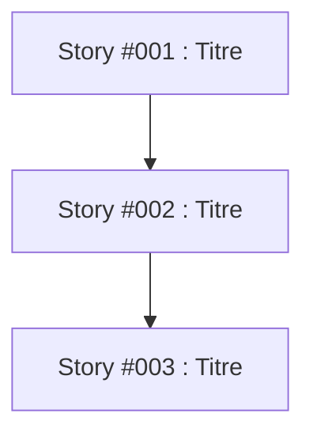

# Skill: Stories (FR)

Ce guide décrit comment générer des user stories à partir d'une spécification en considérant la documentation et l'automatisation des tests.

## Qu'est-ce que je fais

Je découpe une spécification en user stories exploitables, en tenant compte de la documentation du logiciel et de l'automatisation des tests. Chaque story doit apporter une valeur probante à l'utilisateur final.

## Quand m'utiliser

Utilisez cette skill lorsque vous avez une spécification de projet et que vous voulez générer des user stories structurées, testables et documentées.

## Organisation des fichiers (`docs/stories/`)

Les stories vivent sous `docs/stories/`. Chaque story a son propre identifiant **`<id>`** sur 3 chiffres (`001`, `004`, …) — normaliser l'argument utilisateur (`1` → `001`, `story-004` → `004`).

```text
docs/stories/
  <id>/
    story.md              # contenu de la user story
  questions.md            # questions BLOQUANTES uniquement (temporaire — supprimé à la fin)
  assumptions.md          # hypothèses proposées par l'agent (temporaire — supprimé à la fin)
  plan-implementation.md  # plan global multi-stories (généré en fin de workflow)
```

| Fichier | Rôle |
|---------|------|
| `docs/stories/<id>/story.md` | User story #XXX (titre, critères, tests, dépendances) |
| `docs/stories/questions.md` | Questions **bloquantes** nécessitant un arbitrage explicite (peut être omis si aucune) |
| `docs/stories/assumptions.md` | Hypothèses non-bloquantes proposées par l'agent avec justification |
| `docs/stories/plan-implementation.md` | Ordre d'implémentation et dépendances entre stories |

Les **tâches** d'une story sont créées par la skill `tasks-fr` dans `docs/stories/<id>/story/` ; une tâche terminée est renommée `task-YYY-done.md` (voir skill `tasks-fr`).

## Workflow

### Cas 1 : Aucune story n'existe (début depuis zéro)

#### Étape 1 - Brief utilisateur et lecture de la spécification
- L'utilisateur donne le chemin de la spécification en argument (ex: specification.md ou docs/specification/specification.md). Il peut également fournir un **brief direct** (objectifs, acteurs/rôles, périmètre/hors-périmètre, contraintes, stack connue).
- **Extraire le brief** s'il est fourni. Si le brief contient déjà des décisions (rôles, auth, framework de tests, périmètre MVP), **les appliquer directement** sans générer de questions à leur sujet.
- Lire la spécification fournie
- **Inspecter le codebase** pour comprendre la structure existante, la documentation, la stack technique et les patterns de tests déjà en place.
- Créer le répertoire `docs/stories/` s'il n'existe pas

#### Étape 2 - Décisions globales en premier (TOP-DOWN)
- **Identifier les décisions transverses** impactant l'ensemble du lot : acteurs/rôles, périmètre MVP/hors-MVP, authentification/autorisation, stratégie de tests (unitaire/intégration/E2E), frontières API/UI, etc.
- **Si des décisions globales manquent et sont bloquantes** pour générer des critères d'acceptation testables, poser **maximum 3-5 questions globales** dans `docs/stories/questions.md` en utilisant le format condensé (cf. règle qualité ci-dessous).
- **Pour les décisions transverses non-bloquantes** mais utiles : les formuler comme hypothèses dans `docs/stories/assumptions.md` avec justification et impact sur les stories.
- **Attendre les réponses** de l'utilisateur. L'utilisateur peut répondre :
  - "J'ai répondu aux questions, mets à jour les stories" (répondre aux questions bloquantes)
  - "Accepte toutes les hypothèses" (accepter toutes les hypothèses non-bloquantes)
  - "Applique mes directives : ..." (donner des instructions directes à appliquer sans questions)
  - Un retour ciblé par story/ID

#### Étape 3 - Génération initiale des stories
- Générer des user stories qui répondent aux critères :
  - Considèrent la documentation du logiciel existante
  - Intègrent l'automatisation des tests
  - Apportent une valeur probante à l'utilisateur final
- **Appliquer les décisions globales et hypothèses acceptées** à l'intégralité du lot
- Pour chaque story, créer `docs/stories/<id>/` et générer `docs/stories/<id>/story.md` (ex. `../../../docs/stories/001-done`, `../../../docs/stories/002-done`)

#### Étape 4 - Affinage minimal (seulement si nécessaire)
- Analyser le lot de stories générées pour ne détecter que les **blocages réels** :
  - Impossibilité d'écrire des critères d'acceptation testables
  - Contradictions directes entre stories rendant le plan d'implémentation incohérent
  - Dépendances non résolubles sans arbitrage explicite
- **Si des blocages sont détectés** : ajouter **uniquement ces questions bloquantes** dans `docs/stories/questions.md` (maximum 1-2 rounds). Utiliser le format complet uniquement pour de vrais blocages complexes.
- **Si aucun blocage** : générer les hypothèses restantes dans `docs/stories/assumptions.md` et passer directement à l'étape 5.
- L'utilisateur répond via les mêmes formes qu'à l'étape 2.

#### Étape 5 - Génération du plan d'implémentation et fin du workflow
- Après mise à jour, relire rapidement le lot. **Ne pas chercher la perfection** - chercher uniquement s'il reste des blocages empêchant des critères d'acceptation testables ou un plan cohérent.
- Si aucun blocage ne subsiste (questions.md vide ou inexistant) :
  - Supprimer `docs/stories/questions.md` et `docs/stories/assumptions.md`
  - Analyser les dépendances entre les stories (section ## Dépendances de chaque story)
  - Générer le fichier `docs/stories/plan-implementation.md` contenant :
    - Ordre d'implémentation recommandé (basé sur les dépendances, la valeur utilisateur, la complexité)
    - Stories pouvant être développées en parallèle (sans dépendances croisées)
    - Justifications de l'ordre proposé
    - Diagramme de dépendances au format Mermaid
  - Annoncer la fin du workflow
- **Limite stricte** : Au maximum **2 rounds** de questions bloquantes au total. Au-delà, l'agent DOIT formuler des hypothèses raisonnées dans `assumptions.md`, appliquer les plus sûres, et proposer le reste en les marquant clairement.

### Cas 2 : Des stories existent déjà
- Démarrer directement à l'Étape 2 du Cas 1
- Lire les stories existantes dans `docs/stories/*/story.md`
- Analyser de manière pragmatique : d'abord les décisions globales manquantes, puis uniquement les blocages réels
- Appliquer le même principe de clarification minimale (max 2 rounds de questions bloquantes)

## Règle : clarification minimale (obligatoire)

**Remplacer "clarification continue" par "clarification ciblée".**

- **Ne poser que des questions BLOQUANTES** : uniquement celles qui empêchent d'écrire des critères d'acceptation testables, qui créent une contradiction rendant le plan incohérent, ou qui résolvent une dépendance non déductible.
- **Pour le reste, ASSUMER intelligemment** : formuler une hypothèse raisonnée (s'appuyer sur le codebase existant, la doc, les patterns du projet), la lister dans `assumptions.md` avec justification, et l'appliquer directement.
- **Critère d'arrêt** : "Assez clair pour générer des critères d'acceptation testables et un plan d'implémentation cohérent" — PAS "aucune ambiguïté possible".
- **Maximum 2 rounds** : Limiter à 2 itérations de questions bloquantes. Après ça, hypothèses + passage à la génération du plan.
- **Accepter les directives** : Si l'utilisateur donne des instructions directes ("fais comme suit : ..."), les appliquer sans générer de questions à ce sujet.

## Règle : qualité des questions (adaptable)

L'utilisateur doit pouvoir répondre **en connaissance de cause** sans relire l'intégralité du lot.

### Pour les questions GLOBALES ou RAPIDES (préféré)
Format condensé autorisé :
```markdown
### Q[X] - [Contexte court] - [Décision à prendre]
**Enjeu :** Impact sur [stories concernées]
**Question :** [Formulation précise, UNE décision]
**Propositions :**
- a) [Option 1] — Comportement + implications
- b) [Option 2] — Comportement + implications  
- c) Autre : [préciser]
**Réponse :**
```

### Pour les questions VRAIMENT BLOQUANTES et COMPLEXES
Utiliser le format complet (tous les blocs) :
- **Enjeu** - Pourquoi la réponse compte
- **Contexte** - Extraits pertinents, ce qui est déjà décidé, ce qui reste flou, chevauchements
- **Dépendances** - Stories, critères ou tests impactés
- **Question** - Formulation précise, **une** décision
- **Propositions** - ≥ 2 options concrètes (+ « Autre ») ; chaque option explique comportement, implications sur stories/tests, pertinence
- **Réponse** - Emplacement vide

**Règles strictes :**
- **Interdit :** questions sans ancrage story/spec ; options nues sans implications ; plusieurs décisions indépendantes dans une seule question
- **Obligatoire :** citer la story concernée (`Story #00X`), la section (critère, test, dépendance…) si applicable
- **Recommandations justifiées :** si une option est recommandée, justifier sans l'imposer

## Format des fichiers

### Story (`docs/stories/<id>/story.md`)
```markdown
# Story #XXX : [Titre de la story]

## Description
En tant que [rôle], je veux [action] afin de [bénéfice].

## Critères d'acceptation
- [ ] Critère 1
- [ ] Critère 2
- [ ] Critère 3

## Tests automatisés
- Test unitaire : [Description]
- Test d'intégration : [Description]
- Test E2E : [Description]

## Documentation
- [Lien vers la documentation impactée]
- [Nouvelle documentation à créer]

## Valeur utilisateur
[Description de la valeur probante pour l'utilisateur final]

## Dépendances
- [Story #YYY]
- [Documentation existante]
```

### assumptions.md (`docs/stories/assumptions.md`)
```markdown
# Hypothèses - Stories

Généré automatiquement. L'utilisateur peut répondre : "Accepte toutes les hypothèses", invalider certaines par ID, ou donner des directives.

## Décisions globales appliquées
- [APPLIQUÉ] **Rôles** : Admin / User (pas de Guest au MVP) — Justif: non précisé dans la spec, cohérent avec le périmètre minimal — Impacts: #002, #005
- [APPLIQUÉ] **Tests E2E** : Playwright (déjà présent dans le repo) — Justif: détecté dans package.json — Impacts: toutes les stories UI

## Hypothèses à valider (non-bloquantes)
- [À VALIDER] **Nommage API** : REST sous /api/v1 — Justif: pattern existant observé — Impacts: stories API — **Statut**: [ACCEPTÉ / REFUSÉ / À DÉCIDER]
- [À VALIDER] **Stratégie de validation** : côté client + serveur — Justif: approche défensive standard — Impacts: formulaires — **Statut**: [ACCEPTÉ / REFUSÉ / À DÉCIDER]

## Hypothèses sûres (appliquées avec précaution)
- [APPLIQUÉ - RÉVISABLE] **Messages d'erreur** : en français — Justif: app déjà en français — Impacts: UX
```

### questions.md (`docs/stories/questions.md`) - UNIQUEMENT si bloquant
```markdown
# Questions BLOQUANTES - Stories

## Contexte global
- Spécification : [chemin]
- Stories générées / concernées : [liste]
- Round : [1/2] (max 2 rounds)
- Type : Questions bloquantes uniquement

## Questions bloquantes

### 1. [GLOBAL] — Rôles et matrice de permissions
**Enjeu :** Impossible d'écrire des critères d'acceptation testables pour #002 et #005 sans trancher les rôles.
**Question :** Quels rôles doivent exister au MVP et avec quelles permissions ?
**Propositions :**
- a) **Admin / User seulement** — Admin: tout; User: CRUD sur ses propres éléments. Implications: #002 définit authz basique; #005 simplifié; tests × 2 profils.
- b) **Admin / User / Guest (lecture seule)** — Implications: nécessite logique de partage; #002 plus complet; tests × 3 profils.
- c) Autre : fournir une matrice rôle × action détaillée
**Réponse :**

### 2. [Story #002 vs #005] — Contradiction détectée
**Enjeu :** #005 suppose un "invité lecture seule" alors que #002 ne le définit pas. Contradiction directe.
**Contexte :**
- #002: [extrait pertinent]
- #005: [extrait pertinent]
**Question :** Faut-il introduire Guest dans #002, ou retirer toute référence à Guest de #005 ?
**Propositions :**
- a) Introduire Guest dans #002 avec droits lecture seule sur les éléments partagés
- b) Retirer Guest de #005, gérer le partage autrement
- c) Autre
**Réponse :**
```

### plan-implementation.md (`docs/stories/plan-implementation.md`)
```markdown
# Plan d'implémentation des stories

## Ordre d'implémentation recommandé
1. **Story #001** - [Titre] (Priorité : Haute)
   - Justification : [Dépendance nulle, valeur utilisateur élevée]
2. **Story #002** - [Titre] (Priorité : Haute)
   - Justification : [Dépend de Story #001, nécessaire pour les fonctionnalités suivantes]

## Stories développables en parallèle
- **Groupe 1** : Story #003, Story #004 (aucune dépendance croisée)

## Diagramme de dépendances (format Mermaid)


## Notes
- Les stories doivent être implémentées dans l'ordre indiqué pour respecter les dépendances
- Les groupes en parallèle peuvent être développés simultanément par différentes équipes
```

## Comment passer d'une étape à l'autre

| Transition | Action de l'utilisateur | Action de l'agent |
|------------|------------------------|-------------------|
| Début → Brief/Spec | Donner le chemin de la spécification + éventuellement un brief/directives | Extrait le brief, inspecte le codebase, identifie décisions globales |
| Étape 2 → Génération | Répondre aux questions bloquantes OU "Accepte toutes les hypothèses" OU donner directives | Applique décisions globales, génère les stories avec hypothèses appliquées |
| Après génération | "J'ai répondu aux questions, mets à jour les stories" OU "Applique mes directives : ..." | Met à jour uniquement si blocages résolus ou directives appliquées |
| Affinage → Plan | Automatique si plus de blocages après relecture (max 2 rounds) | Supprime questions.md/assumptions.md, génère plan-implementation.md, annonce la fin |

**Important :** L'agent ne surveille pas les modifications de fichiers en temps réel. L'utilisateur doit toujours donner une instruction explicite pour que l'agent passe à l'étape suivante.

**Astuce pour guider l'agent :** Plus vous donnez de directives en début (rôles, périmètre, stack, framework de tests), moins de questions seront posées. L'agent privilégiera toujours l'application de vos directives sur la génération de questions.
