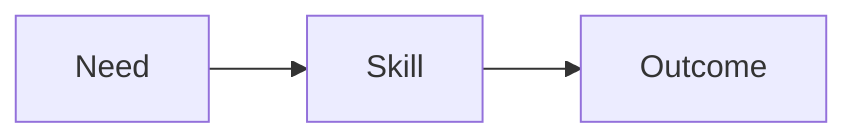

# Talk deck

Cette skill transforme un découpage clos en deck Marp précis, concis et visuel. Elle dépose aussi un thème modifiable et les scripts qui génèrent le HTML et le PDF. Elle ne change pas le cadrage ni le découpage, sauf pour remettre une idée `accepted` qui a disparu de sa destination.

## Limites

- Ne pas inventer une slide, une idée ou un support absents de `slide-outline.md`.
- Ne pas afficher à l'audience une consigne du découpage, par exemple « one short excerpt ».
- Ne pas inspecter le dépôt pour trouver un extrait, sauf demande explicite de l'utilisateur.
- Ne pas réécrire le texte de l'utilisateur dans `questions.md`, ni l'idée d'une entrée de `feedback.md`.
- Ne pas écraser `theme.css` s'il existe : c'est le template visuel modifiable.
- Si un helper de build existe et ne prépare pas Mermaid, demander avant de le remplacer.
- Ne pas hotlinker une image distante dans le deck.
- Ne pas utiliser une image décorative qui n'aide pas à comprendre ou mémoriser l'idée.
- Ne pas lancer le build tant que l'utilisateur ne le demande pas.

## Entrée

L'utilisateur fournit un répertoire de présentation, par exemple :

```text
docs/presentations/skill-based-dev-system/
```

S'il ne le fournit pas, demander le chemin avant de créer des fichiers.

Le répertoire doit contenir `slide-outline.md`. S'il manque, s'arrêter et demander d'abord `talk-slides`. Ne pas inventer de découpage.

Respecter les règles de langue du dépôt. Dans CRBPM, la conversation peut être en français, mais les fichiers sous `docs/` sont en anglais.

## Fichiers

Dans le répertoire de la présentation :

```text
slide-outline.md
slide-deck.md
theme.css
build.ps1
build.sh
prepare-mermaid.mjs
assets/
  SOURCES.md
feedback.md
questions.md
```

`dist/slide-deck.html` et `dist/slide-deck.pdf` n'apparaissent que lorsque l'utilisateur demande le build. Le HTML référence `assets/` à côté de lui : le build copie donc `assets/` vers `dist/assets/`.

Les modèles à copier sont dans `.cursor/skills/talk-deck/templates/` :

```text
theme.css
build.ps1
build.sh
prepare-mermaid.mjs
```

- `slide-deck.md` est le deck Marp, régénéré à partir du découpage.
- `theme.css` est le template modifiable. Le nom du thème est `talk`.
- `prepare-mermaid.mjs` convertit les blocs Mermaid en SVG locaux.
- `build.ps1` et `build.sh` préparent Mermaid puis génèrent le HTML, le PDF, ou les deux.
- `assets/SOURCES.md` donne, pour chaque image externe, son URL, son auteur et sa licence.

## État de feedback.md

Même règle que `talk-init` et `talk-slides`. Le statut fait foi, pas le titre de section.

- `new` — pas encore triée, sous `## Open`.
- `held` — pas incluse, sous `## Open`.
- `accepted` — incluse, sous `## Resolved`, avec une note de destination.

À chaque passage :

- lire le statut de chaque entrée ;
- pour `accepted`, vérifier que l'idée est encore dans la destination notée, y compris dans `slide-deck.md` si la note le cite. Si elle y est, ne pas la reposer. Si elle a disparu, la remettre à cet endroit ;
- pour `held` ou `new`, ne pas les traiter comme incluses. Une entrée `new` ou `held` bloque le deck ;
- avant de terminer, dire le compte : `accepted`, `held`, `new`.

## Texte du deck

Une slide du découpage devient une slide Marp, séparée par `---`.

- Une idée par slide.
- Transformer l'idée générale en titre actif de 10 mots maximum, sans perte de sens.
- Corps : 25 mots maximum, hors code, légende et attribution.
- Au plus 3 puces de 7 mots chacune. Préférer mots-clés, verbes et nombres.
- Supprimer introductions, répétitions, transitions écrites et phrases que l'orateur peut dire.
- Garder les termes précis, les contraintes, les contrastes et les chiffres.
- Si une idée ne peut pas être raccourcie sans devenir vague, poser une question.
- Le titre d'ouverture et la clôture portent la classe `lead`.
- Une entrée de `Not on slides` n'a pas de slide.
- Un support qui demande un extrait de fichier n'est pas une puce. C'est un bloc de code, et seulement si le texte de l'extrait est déjà dans le répertoire de la présentation ou fourni par l'utilisateur. Sinon, poser une question. Ne pas inventer le code.

## Visuels

Pour chaque slide de contenu, décider si un visuel explique l'idée plus vite que du texte.

Priorité :

1. **Diagramme Mermaid** pour flux, séquence, hiérarchie, cycle ou comparaison structurée.
2. **Image générée** pour métaphore ou concept sans source factuelle.
3. **Image web** pour objet, personne, produit ou contexte réel.
4. **Placeholder** si le visuel utile ne peut pas être généré ou correctement sourcé.

Règles :

- Un visuel dominant maximum par slide. Le texte restant l'explique, il ne le répète pas.
- Générer l'image avec l'outil disponible quand le concept est abstrait et que le résultat n'a pas besoin d'être factuel.
- Pour une image web, rechercher une source réutilisable, télécharger l'image sous `assets/`, et inscrire URL, auteur et licence dans `assets/SOURCES.md`. Ne pas utiliser une image dont la licence est inconnue.
- Si aucun visuel fiable n'est disponible, créer sous `assets/placeholders/` un SVG affichant `IMAGE NEEDED` et une consigne de recherche précise. Utiliser ce fichier dans la slide.
- Donner à chaque image un texte alternatif descriptif.
- Pour Mermaid, écrire un diagramme petit et lisible : 7 nœuds maximum par figure. Le premier commentaire peut définir le texte alternatif : `%% alt: Workflow from need to skill`.
- Le build remplace chaque bloc `mermaid` par un SVG sous `assets/generated/`.

En-tête du deck :

```markdown
---
marp: true
theme: talk
paginate: true
---
```

## Workflow

### 1. Lire

Lire `slide-outline.md`, `presentation-brief.md`, `feedback.md`, `questions.md` et `slide-deck.md` s'ils existent.

S'arrêter si `questions.md` contient encore une question de `talk-slides` sans réponse, ou si le brief contient `[TO CLARIFY]`.

### 2. Vérifier les feedbacks

Appliquer l'état de `feedback.md`. S'il reste une entrée `new` ou `held`, écrire la question dans `questions.md` et ne pas générer le deck comme s'il était clos.

### 3. Bloquer ce qui empêcherait un deck fidèle

Écrire une question, et ne pas deviner, quand :

- une slide n'a pas une seule idée générale ;
- une slide a plus de trois supports ;
- un support demande un extrait dont le texte n'est pas fourni ;
- le texte ne peut pas respecter les limites de concision sans perdre un élément essentiel ;
- un visuel est nécessaire mais sa génération, sa source ou son placeholder demande un choix éditorial ;
- le deck existant contredit le découpage et le choix n'est pas évident.

Conserver le texte de l'utilisateur dans `## Feedback`. Remplacer seulement `## Questions`.

Puis résumer en chat, demander de répondre et de dire explicitement de continuer, et s'arrêter.

### 4. Écrire le deck

Créer ou mettre à jour `slide-deck.md`.

Créer les visuels nécessaires. Créer `assets/SOURCES.md` dès qu'une image web est utilisée.

S'ils sont absents, copier `theme.css`, `build.ps1`, `build.sh` et `prepare-mermaid.mjs` depuis `templates/`.

S'ils existent :

- garder `theme.css` ;
- vérifier que les deux scripts appellent `prepare-mermaid.mjs` avant Marp ;
- garder les helpers compatibles ;
- demander avant de remplacer un helper incompatible.

### 5. Clôturer

Le deck est prêt uniquement lorsque :

- chaque slide du découpage a une slide Marp, et aucune slide en trop ;
- chaque slide respecte les limites de concision ;
- chaque visuel apporte une information et possède un texte alternatif ;
- chaque image web est locale et sourcée ;
- chaque bloc Mermaid peut être converti par `prepare-mermaid.mjs` ;
- les deux scripts de build préparent Mermaid avant Marp ;
- chaque entrée `accepted` est présente dans la destination notée ;
- aucune entrée `new` ou `held` ne reste ;
- aucune question utile ne reste.

Laisser `questions.md` en place. Vider `## Questions` en indiquant qu'aucune question n'est ouverte. Conserver `## Feedback`.

Annoncer le compte des feedbacks, le chemin de `slide-deck.md`, et les commandes de build. Ne pas lancer le build tant que l'utilisateur ne le demande pas.

Commandes, depuis le répertoire de la présentation :

```text
./build.sh
./build.sh html
./build.sh pdf
```

```text
.\build.ps1
.\build.ps1 -Target html
.\build.ps1 -Target pdf
```

Le premier build télécharge Marp et Mermaid CLI avec `npx`. Mermaid et le PDF exigent Chrome, Edge ou Chromium. `CHROME_PATH` peut indiquer l'exécutable.

## Modèle de slide

```markdown
<!-- _class: lead -->

# General idea of a framing slide

---

# General idea of a content slide

- Short support


---

# Short process title


```
