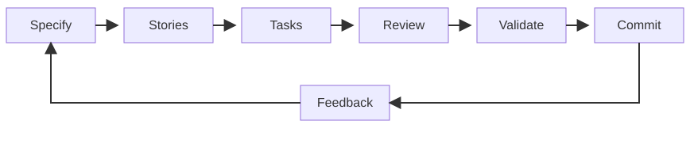

<!-- _class: lead -->

# Stay on the work you do well

- Show your strengths, not the AI's
- Delegate what you struggle with
- AI adapt the world to each person

---

# My Development Workflow

- Tasks: prompts to generate code, docs, tests
- Validate: close to production

---

# Integrate AI agents in your environment

- IntelliJ, ACP, Cursor, custom commands
- Native language keeps the subtleties
- Question loops until you decide

---

# Demo: specification and near-prod tests

- specification-en/fr : specification workflow
- run-tests-dood: changes validation, close to production

---

# Keep the work in local Markdown

- Centralize everything near the code
- Avoid external systems: Spend fewer tokens

---

# Ask Cursor to write the skill

- Focus on what you are good at and build around it
- State precisely the expected result
- State where you need guidance
- You need to understand Generative AI concepts: skill, rules, agents, …

---

<!-- _class: lead -->

# Start from a real personal problem

- Maximize the value of the work your are good at
- Delegate the work you struggle with
- Inspiration: BMAD and harness engineering
- Specify context, not instructions
- Extrapolate from existing skills.
  - Eg: generate this talks: talk-init, talk-slide, talk-deck
